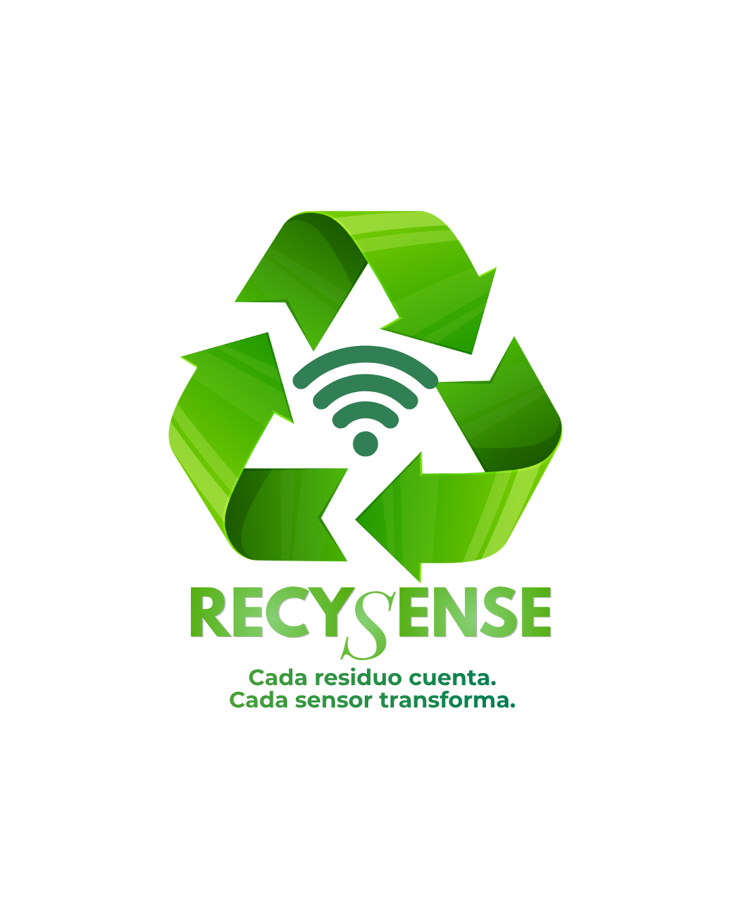

# RecySense

<p align="center">
  
</p>

<p align="center">
  <strong>IoT-Powered Smart Recycling Points & Environmental Monitoring Console</strong><br>
  <em>Universidad Central del Este (UCE)</em>
</p>

---

##  About the Project

**RecySense** is an intelligent waste monitoring and recycling management system designed to optimize solid waste collection and foster sustainable habits.

The solution integrates IoT hardware stations with a cloud-connected web console. Each smart recycling station automates the counting and volumetric tracking of three distinct waste streams: **Paper**, **Cardboard**, and **Plastic**. By rotating and tracking stations across key campus locations—**Station A (Laboratories)** and **Station B (Library)**—RecySense provides real-time visibility into waste volume, peak activity hours, and container capacity to enable data-driven environmental management.

---

##  Key Features

- **Real-Time IoT Telemetry**: Instant visualization of deposited waste counts and container fill percentages via live Supabase WebSocket subscriptions.
- **Dual-Station Location Tracking**: Independent tracking and comparative flow analysis between **Station A (Laboratories)** and **Station B (Library)**.
- **Hourly Shift Segmentation**: Waste intake is classified across academic activity shifts:
  - *Morning* (08:00 – 12:00)
  - *Afternoon* (12:00 – 18:00)
  - *Evening* (18:00 – 00:00)
- **Automated Critical Fill Alerts**: Real-time notifications and automated email dispatches when any bin reaches or exceeds **85% capacity**, including a debounce cooldown to prevent notification fatigue.
- **Comprehensive Reporting & Export Suite**: Generates classified and consolidated reports with hourly activity graphs and comparative location analytics, downloadable as:
  - 📄 **PDF** (via jsPDF & html2canvas)
  - 📊 **Excel (.xlsx)** (via SheetJS)
  - 📝 **Word (.docx)** (via docx.js)
  - 🖼️ **Image (.png)**
- **Role-Based Access Control (RBAC)**: Secure access hierarchy separating **Administrators** from **Common Users**, featuring user invitation, role promotions/demotions, and an approval queue for pending sign-up requests.
- **Responsive Mobile Interface**: Fully adaptive interface featuring a slide-out drawer, mobile-optimized navigation, and responsive data tables.

---

##  Tools & Technologies

### Hardware
| Component | Purpose |
| :--- | :--- |
| **ESP32 Microcontroller** | Central processing unit handling sensor inputs and transmitting data via Wi-Fi |
| **3x Infrared (IR) Sensors** | Detect the insertion and passage of waste items (Paper, Cardboard, Plastic) |
| **3x Ultrasonic Sensors (HC-SR04)** | Measure the distance from container tops to calculate volumetric fill levels (%) |

### Backend & Cloud
| Technology | Purpose |
| :--- | :--- |
| **Supabase** | Cloud platform providing PostgreSQL database, Auth, and Realtime WebSocket engine |
| **PostgreSQL** | Relational storage for deposit logs, station snapshots, user profiles, and access requests |
| **Supabase Realtime** | Push-based pub/sub notifications for incoming ESP32 readings without manual polling |

### Frontend & Libraries
| Technology | Purpose |
| :--- | :--- |
| **Vanilla JavaScript (ES6+)** | Pure client-side logic organized in a clean 3-tier modular architecture |
| **HTML5 & CSS3** | Semantic structure and custom styling with smooth transitions |
| **Tailwind CSS (CDN)** | Utility-first responsive design and layout styling |
| **Lucide Icons** | Iconography across navigation, action buttons, and status indicators |
| **Chart.js** | Dynamic bar charts and hourly distribution visualizations |
| **SheetJS (xlsx)** | Client-side Excel workbook compilation and export |
| **docx.js** | Native Microsoft Word (.docx) document generation |
| **jsPDF & html2canvas** | High-fidelity printable PDF and image generation |

---

##  System Architecture

RecySense is structured around an end-to-end IoT pipeline and a modular **3-Tier Frontend Architecture**:

```
[ ESP32 Smart Station ]
  ├── 3x IR Sensors (Deposit Counts)
  └── 3x Ultrasonic Sensors (Fill Levels)
            │  (Wi-Fi / HTTPS)
            ▼
[ Supabase Cloud (PostgreSQL + Realtime) ]
            │  (WebSocket / REST API)
            ▼
[ RecySense Web Console (Client) ]
  ├── Presentation Layer  (UI Rendering, Charts, DOM Events, Skeleton Loaders)
  ├── Business Logic Layer (Alert Engine, Shift Service, Report Generators)
  └── Data Access Layer    (Repositories, Supabase Client, Auth Handlers)
```

### 1. Hardware-to-Cloud Flow
1. An item is deposited through one of the three labeled inlets (Paper, Cardboard, Plastic).
2. The corresponding **IR sensor** registers the passage, while the **ultrasonic sensor** measures the current distance to the waste surface.
3. The **ESP32** computes the fill level percentage and transmits the payload to Supabase over Wi-Fi.

### 2. Frontend Layer Breakdown

```
Js/
├── config.js               # Global configuration, thresholds, waste types & station definitions
├── config.local.js         # Local environment keys (Supabase URL & Anon Key)
├── main.js                 # Application bootstrap, routing, and event orchestration
│
├── presentation/           # [PRESENTATION LAYER]
│   ├── ui.js               # View rendering (Dashboard, Reports, Admin panels, Charts)
│   └── skeletonUI.js       # Skeleton loading indicators for seamless data transitions
│
├── business/               # [BUSINESS LOGIC LAYER]
│   ├── alertService.js     # Evaluates 85% fill threshold, triggers emails & UI toasts
│   ├── authService.js      # Role authorization, login, reset, and request workflows
│   ├── reportService.js    # Metric aggregations and exports (PDF, Excel, Word, Image)
│   └── shiftService.js     # Time shift categorizer (Morning, Afternoon, Evening)
│
└── data/                   # [DATA ACCESS LAYER]
    ├── supabaseClient.js   # Supabase client initialization
    ├── wasteRepository.js  # Waste telemetry queries, fallback station counting & realtime subscriptions
    └── authRepository.js   # Profiles, role queries, and access request table operations
```

---

##  Project Structure

```
Proyecto-contenedores de reciclaje inteligentes/
├── assets/
│   └── Logo.png              # RecySense official branding logo
├── css/
│   └── styles.css            # Custom animations, transitions, and component overrides
├── Js/
│   ├── business/             # Core business rules and export processors
│   ├── data/                 # Repositories and external service clients
│   ├── presentation/         # UI builders, views, and chart lifecycle managers
│   ├── config.js             # Project constants and station metadata
│   ├── config.local.js       # Private Supabase credentials
│   └── main.js               # Main entry point and event wiring
├── .gitignore                # Git ignore rules (environment keys, sensitive configs)
├── index.html                # Single-Page Application container
└── README.md                 # Project documentation
```

---

##  Getting Started

### Prerequisites
- A modern web browser (Chrome, Firefox, Edge, Safari).
- A [Supabase](https://supabase.com/) account and project with configured tables (`waste_readings`, `profiles`, `access_requests`).

### Setup & Configuration

1. **Clone the repository:**
   ```bash
   git clone https://github.com/<your-username>/Proyecto-contenedores-de-reciclaje-inteligentes.git
   cd Proyecto-contenedores-de-reciclaje-inteligentes
   ```

2. **Configure Supabase Credentials:**
   Create or verify the `Js/config.local.js` file with your Supabase project keys:
   ```javascript
   export const LOCAL_CONFIG = {
     SUPABASE_URL: 'https://your-project.supabase.co',
     SUPABASE_ANON_KEY: 'your-anon-key'
   };
   ```

3. **Run the Application:**
   Because the project uses standard ES6 modules (`type="module"`), serve the root folder with any local web server:
   - **VS Code**: Use the [Live Server](https://marketplace.visualstudio.com/items?itemName=ritwickdey.LiveServer) extension.
   - **Python**:
     ```bash
     python -m http.server 8000
     ```
   - **Node.js (npx)**:
     ```bash
     npx serve .
     ```
   Open your browser at `http://localhost:8000` (or the port specified by your server).

---

##  Authors & Academic Context

Developed for the **Universidad Central del Este (UCE)** like a prototype as part of the Engineering Innovation and Environmental Sustainability initiatives. This prototype will not be permanently at the institution..
